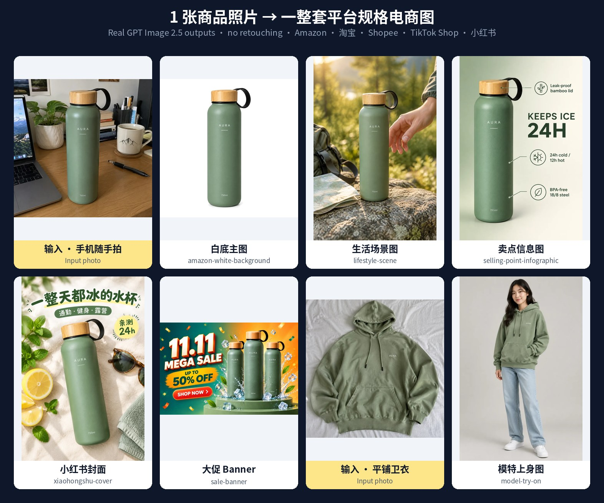
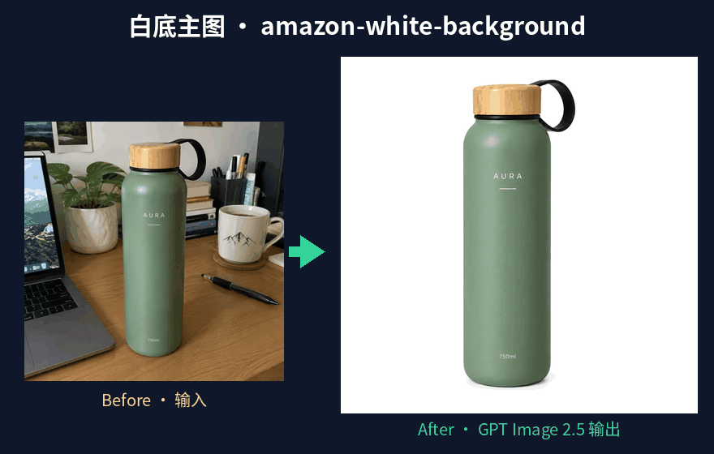
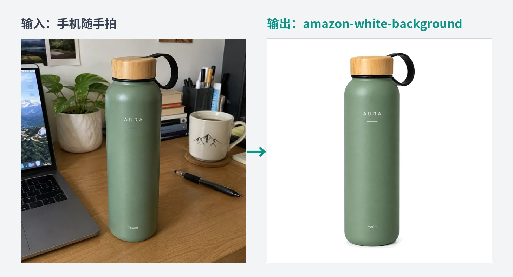
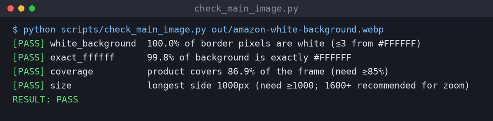
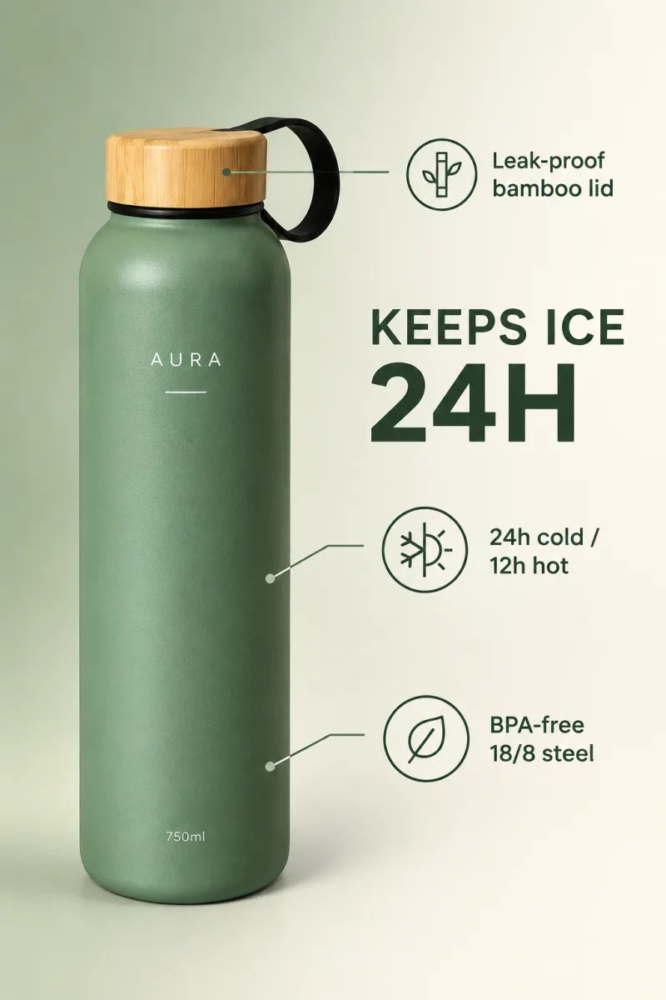
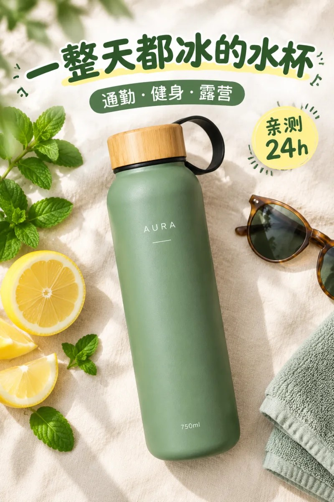

> 在线阅读（GitHub Pages）：https://maynor996.github.io/ecommerce-main-image-skills/

# 开源了！12个Claude Skills，一张手机随手拍自动生成整套电商主图（亚马逊白底/A+/小红书封面/详情长图）

## 开源了！12个Claude Skills，一张手机随手拍自动生成整套电商主图（亚马逊白底/A+/小红书封面/详情长图）

> 一句话介绍：**ecommerce-image-skills** 是一套开源的 Agent Skills，装进 Claude Code / Codex / Cursor 后，丢一张商品照片给 Agent，它会按平台规则出白底主图、场景图、卖点图、A+ 模块、尺寸图、模特图、大促 Banner、小红书封面和淘宝详情长图，并用脚本做质检。
> 
> 仓库地址：https://github.com/xianyu110/ecommerce-image-skills （MIT 协议）

### 一、先说痛点：做一套商品图到底有多麻烦

做过跨境或者淘宝的朋友应该都经历过：

  * **一个 SKU 要十几张图** ：Amazon 主图 + 6 张副图 + A+，淘宝 5 张主图 + 750 宽详情页，小红书还要 3:4 封面……
  * **每个平台规则不一样** ：Amazon 主图要纯白 `#FFFFFF`、主体占画面 85% 以上、不能有文字；淘宝详情页宽度 750；小红书封面 3:4。
  * **直接让 AI 画，产品经常“被改了”** ：图是好看了，但瓶盖变了、Logo 拼错了、颜色偏了，根本没法上架。

我试过把这些规则写成一堆 prompt，结果是：prompt 越写越长，换个产品又要重来，而且“白底到底白不白、占比够不够”还得自己拿 PS 去量。

所以干脆把这件事拆成了 12 个可单独安装的 Agent Skill，规则、模板、质检脚本全部写进去，让 Agent 按流程干活。

### 二、项目是什么

每个 Skill 就是一个文件夹：`SKILL.md`（流程 + 提示词模板 + 质检清单）+ `scripts/`（确定性的 Python 脚本）。和单纯的 prompt 合集相比，它多做了这几件事：

特性| 具体做法  
---|---  
🔒 产品身份锁定| 每个 skill 第一步先写 `PRODUCT IDENTITY LOCK`（形状/颜色/Logo/文字/配件），原样带进每一条提示词，减少“产品被改”  
📐 平台规格内置| Amazon 主图（#FFFFFF、≥85%）、A+ 模块尺寸、淘宝 750 宽详情、小红书 3:4、各平台 Banner 尺寸  
🧠 模型路由| 默认 GPT Image 2.5 **Flare** （快、适合场景和多版本）；要保 Logo/小字、做局部编辑时切 **Sunburst**  
🛠 脚本做确定性的事| 白底/占比检查与修复、A+ 裁切、拼图、详情页拼接切片、批量换背景（断点续跑 + 预算上限）  
🚦 三种出图方式| ① Agent 自带生图工具 ② 配 `GPTIMAGE_API_KEY` 用 `generate.py` ③ 都没有就输出最终提示词 + 在线运行链接  
  

### 三、技能清单（12 个）

Skill| 做什么| 默认模型  
---|---|---  
`amazon-white-background`| Amazon 白底主图：纯白 #FFFFFF、主体 ≥85%、无文字，附检查/修复脚本| Sunburst  
`lifestyle-scene`| 生活场景图：厨房/户外/办公/健身等场景库，产品保真| Flare  
`model-try-on`| 模特上身图：平铺/挂拍 → 模特试穿，保留面料、颜色、Logo| Sunburst  
`selling-point-infographic`| 卖点信息图：一图一卖点、图标 + 标注线，文案逐字确认| Sunburst  
`amazon-a-plus`| A+ 模块：970×600 / 970×300 / 300×300 / 1464×600…，风格锁 + 裁切脚本| Flare  
`size-chart`| 尺寸规格图：cm/inch 双单位、服装尺码表，数字只用用户提供的| Sunburst  
`multi-angle-set`| 多角度套图：正/侧/背/顶/45°/细节，统一光位 + 拼图脚本| Sunburst  
`sale-banner`| 大促 Banner：淘宝天猫 / Shopee / Lazada / TikTok Shop / Amazon| Flare  
`batch-background-swap`| 批量换背景 / SKU 换色：断点续跑、重试、预算上限、CSV 日志| Sunburst  
`xiaohongshu-cover`| 小红书 3:4 封面：6 种版式、大字标题| Flare  
`taobao-detail-long-image`| 淘宝/天猫/拼多多 750 宽详情长图：分屏规划 + 拼接切片脚本| Flare  
`ecommerce-listing-suite`| 总入口：按平台规划整套图，调度上面 11 个 skill 并质检| Auto  
  
### 四、安装

**方式 1：skills CLI 一行安装（推荐）**
    
    
    npx skills add xianyu110/ecommerce-image-skills
    

Claude Code 用户也可以走插件市场：
    
    
    /plugin marketplace add xianyu110/ecommerce-image-skills
    

**方式 2：手动复制**
    
    
    git clone https://github.com/xianyu110/ecommerce-image-skills.git
    cd ecommerce-image-skills
    
    # Claude Code（全局；或复制到项目内 .claude/skills/）
    mkdir -p ~/.claude/skills && cp -r skills/* ~/.claude/skills/
    # Codex
    mkdir -p ~/.codex/skills && cp -r skills/* ~/.codex/skills/
    # Cursor（项目内）
    mkdir -p .cursor/skills && cp -r skills/* .cursor/skills/
    

只想要某一个？复制对应文件夹即可，比如 `cp -r skills/amazon-white-background ~/.claude/skills/`。每个 skill 自带所需脚本，互不依赖。

### 五、实战：从一张随手拍到一张能过检的亚马逊白底主图

下面用仓库自带的演示商品「AURA」水杯（AI 生成的虚构产品）走一遍。

#### Step 1：直接对 Agent 说人话
    
    
    用 amazon-white-background 把 ./photos/bottle.jpg 做成亚马逊白底主图，并跑检查脚本
    

Agent 加载 skill 后，第一步不是急着出图，而是先写身份锁：
    
    
    PRODUCT IDENTITY LOCK (do not change):
    - Shape & proportions: tall cylinder, rounded shoulders
    - Colour & finish: matte sage green body, natural bamboo lid
    - Logo & printed text: white "AURA" wordmark centred on upper body
    - Parts & details: black carry loop on the lid
    - Must NOT appear: accessories not in the box, extra logos, invented claims
    

skill 里写死了规则：**只用照片里看得到、或用户确认过的事实** ，容量、材质不知道就问或者不写，不编参数、不编认证。

#### Step 2：出图（有 Key 就走脚本）

如果你的 Agent 自带生图工具，它会直接调用；没有的话配一个 OpenAI 兼容接口，用自带的零依赖脚本：
    
    
    export GPTIMAGE_API_KEY=sk-...
    export GPTIMAGE_BASE_URL=https://tryallapi.com/v1   # 任意 OpenAI 兼容网关都行，默认 https://api.openai.com
    python skills/amazon-white-background/scripts/generate.py --model sunburst \
      --image bottle.jpg --size 1024x1024 --prompt-file prompt.txt --out out/main.png
    

`--image` 可以重复传多张（正面/侧面/Logo 特写），不传就是文生图。

#### Step 3：跑质检脚本（这一步是重点）

白底“看起来白”不等于“真的是 #FFFFFF”。skill 要求交付前必须跑检查：
    
    
    pip install pillow numpy   # 只需一次
    python scripts/check_main_image.py out/amazon-white-background.webp
    # 可选参数：--min-coverage 0.85 --min-size 1600 --tolerance 3
    

下面是我对仓库展示图实际跑出来的结果：

脚本检查 4 项：边缘白色占比、背景纯 `#FFFFFF` 占比、主体覆盖率（≥85%）、最长边像素。如果白底偏灰，用 `--fix out.png` 把近白像素统一成 `#FFFFFF`；覆盖率不够，`--fix` 也会按 87% 重新裁切。

> 说明一下：这张 1000px 的展示图满足最低要求，但 skill 里写的推荐尺寸是 1600–2000px（方便缩放查看），正式上架建议按推荐尺寸出。

#### Step 4：一键出整套图

单张跑通后，可以交给总入口：
    
    
    给这个水杯出一整套 Amazon 7 张图（ecommerce-listing-suite），先给我计划
    

它会先出一张计划表（`# | 素材 | skill | 尺寸 | 模型 | 文案`），**你确认后才开始生成** （省钱），然后逐张调度对应 skill，最后给每张图一份 QA：产品身份 ✔/✘ · 平台规格 ✔/✘ · 文字拼写 ✔/✘，只重做不合格的那张。

### 六、效果展示

以下都是 skill 的真实输出（GPT Image 2.5，未 PS）：

**卖点信息图** （`selling-point-infographic`，Sunburst，英文文案逐字渲染）：

**小红书封面** （`xiaohongshu-cover`，Flare，中文大字标题 3:4）：

**大促 Banner** （`sale-banner`，Flare，11.11 Shopee / TikTok Shop 风格）：

### 七、进阶技巧

**1\. 批量换背景 / SKU 换色，带预算上限**

40 张图换纯白底，不想一不小心烧掉一堆额度：
    
    
    python scripts/batch_edit.py ./photos ./out \
      --prompt-file swap.txt --model sunburst --size 1024x1024 \
      --max-images 50 --retries 2
    
    # 换色：每个颜色出一份，prompt 里的 {colour} 会被替换
    python scripts/batch_edit.py ./photos ./out --prompt-file recolor.txt \
      --var colour="Navy Blue (#1F2A44)" --var colour="Coral (#FF6F61)"
    

脚本会跳过 `out/` 里已存在的文件（断点续跑），失败自动重试，并写 `out/log.csv`。skill 里还建议**先拿 2 张图试跑** 再全量。

**2\. 淘宝详情长图：先分屏，再拼接切片**

`taobao-detail-long-image` 默认 8 屏结构（首屏 → 痛点 → 卖点×3 → 场景 → 细节 → 参数售后），所有屏共用一段 STYLE LOCK 保证风格一致，最后：
    
    
    python scripts/stitch_long_image.py s1.png s2.png s3.png ... --width 750 --slice 1546 --out detail-750.jpg
    

skill 里也提醒了广告法：避免“最/第一/国家级/绝对”，“保温 24h、食品级”这类说法必须能证明。

**3\. 什么时候切 Sunburst**

画面里有必须逐字正确的 Logo、标签、小字，或者是“只换背景其他都不动”的局部编辑，就切 Sunburst；其余场景、草稿、多版本用 Flare 更快。

### 八、没有 Claude / API？

这些 skill 跑在 Claude Code / Codex / Cursor 等 Agent 里；用脚本出图时需要一个 OpenAI 兼容接口。还没有的话：

  * **方法一 · Claude 国内镜像站** ：`https://claude-opus.top/` —— 国内直接用 Claude，把 `SKILL.md` 贴进去也能按流程出提示词
  * **方法二 · 一站式 API** ：`https://tryallapi.com/register?aff=5A6A` —— Claude / GPT / Gemini 一个 Key，设置 `GPTIMAGE_BASE_URL=https://tryallapi.com/v1` 即可给 `generate.py` 出图
  * **不想配环境，只想在线出图** ：`https://gptimage2.asia/` —— 浏览器里直接用 GPT Image 2.5，把 skill 里的提示词贴进去、上传商品图即可

### 九、写在最后

这个项目的思路其实很简单：**把美工脑子里的平台规则和检查动作写成 Agent 能执行的流程** ，AI 负责出图，脚本负责“量尺寸、验白底”这种不能靠感觉的事。

平台规则会变，上架前请以各平台卖家后台的最新说明为准。新平台规格、更好的模板、更多脚本，欢迎提 PR。

如果这套 skill 帮你省下了一个下午的美工时间，欢迎点个 ⭐ Star，让更多卖家看到：

👉 **https://github.com/xianyu110/ecommerce-image-skills**

**姊妹仓库，同一套用法：**

  * 电商短视频 Skills（商品图 → 带配音字幕的 9:16 带货视频）：https://github.com/xianyu110/ecommerce-video-skills
  * 品牌 IP 视觉套件 Skills（IP 形象 · Logo · VI · 包装 · 表情包）：https://github.com/xianyu110/brand-ip-kit-skills
  * 国内上线 Skills（ICP 备案 · 微信/支付宝支付 · 小程序 · 隐私合规）：https://github.com/xianyu110/golive-china-skills

* * *

我是 MaynorAI 团队，分享 AI 编程、AI SaaS 工具出海、一人团队搭建经验。